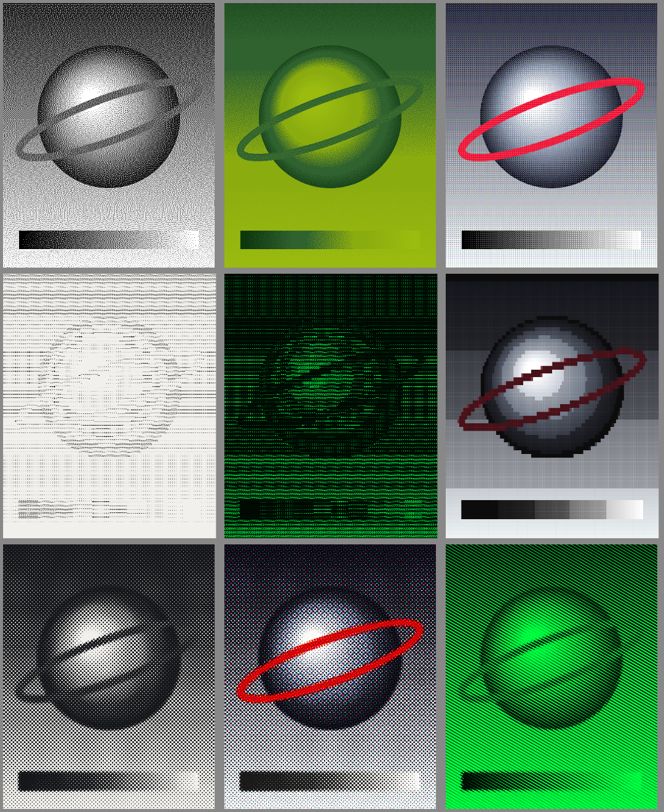

# ditherlab

Turn any image into **ASCII art**, a **dithered** bitmap, or a **halftone** print.
Everything runs in the browser. No libraries, no build step, no server.



## Features

- **ASCII**: five built-in character ramps or your own, five colour looks, optional per-character colour from the image, export to PNG, copy text, or download `.txt`.
- **Dither**: Floyd-Steinberg, Atkinson, Jarvis-Judice-Ninke, Burkes, Sierra Lite, Bayer 2x2 / 4x4 / 8x8, threshold and noise. Palette tones (Game Boy, CGA, terminal green, neon red...) or full colour with 2 to 8 levels per channel.
- **Halftone**: circles, squares or lines at any angle; dot gain; single ink or four-colour CMYK screens.
- **Tone controls**: brightness, contrast, gamma, invert, auto levels.
- **Input**: drag and drop, paste from the clipboard, or choose a file. A sample image is built in.
- **Export**: PNG at 1x to 8x. Dither is enlarged with hard pixel edges; ASCII and halftone are redrawn sharp at the larger size.

## Run it

Open `index.html` in a browser. That is all. (The scripts are plain `<script>` tags, so it works from a file or any static host.)

```
python3 -m http.server 8000     # optional: serve it at http://localhost:8000
```

## Test it

Needs Node 18 or newer. The algorithm files are plain functions with no DOM, so they run in Node.

```
node --test
```

## Build one self-contained file

```
node tools/build.js             # writes dist/ditherlab.html with CSS and JS inlined
```

## Project layout

```
index.html          page and controls
css/style.css       look (light and dark mode)
js/core.js          shared helpers: pixel conversion, tone, summed-area table, presets
js/ascii.js         brightness -> characters, text drawing
js/dither.js        error diffusion, Bayer ordered dither, palette and colour output
js/halftone.js      rotated dot screens, CMYK
js/app.js           UI wiring, rendering pipeline, export
test/               unit tests (node --test)
tools/build.js      single-file build
```

## How it works, in short

1. The image is drawn to a hidden canvas at a working size and read as pixels.
2. Tone controls are applied (brightness, contrast, gamma, invert, auto levels).
3. The chosen mode converts the pixels (see the technical specification for the algorithms).
4. The result is drawn to the preview canvas. Exports re-run the same pipeline at a larger scale.

## Publish on GitHub Pages

Push the folder to a repository, then Settings, Pages, deploy from branch `main`, folder `/ (root)`.
All paths in `index.html` are relative, so it works from a project subfolder.

## Documentation

The full technical specification (every section, how it is built and why) is provided separately as a document.
Export it to Markdown and save it as `docs/SPEC.md` if you want it inside the repository.

## Licence

MIT. See `LICENSE`.
